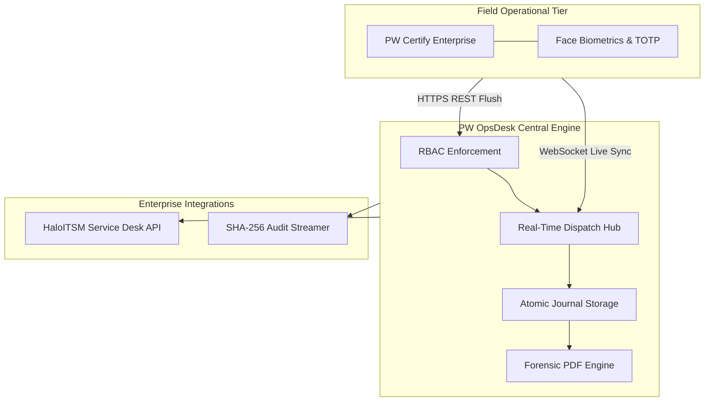
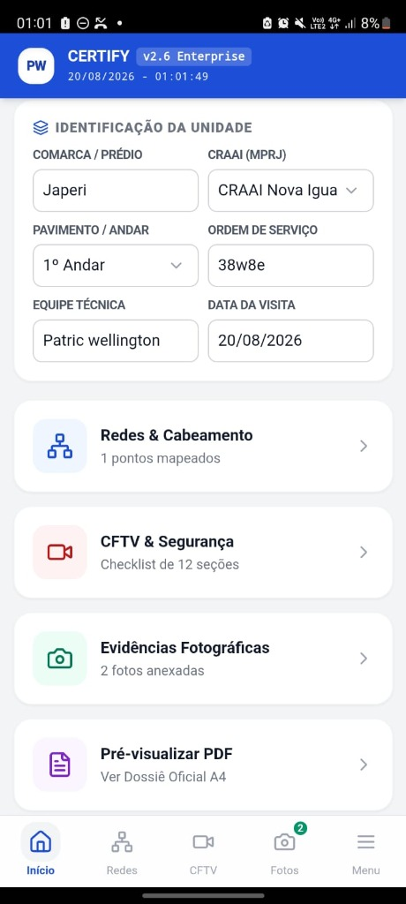
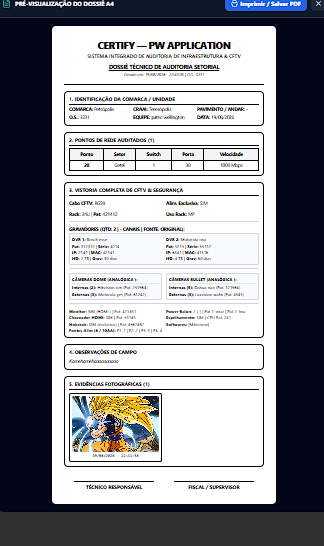
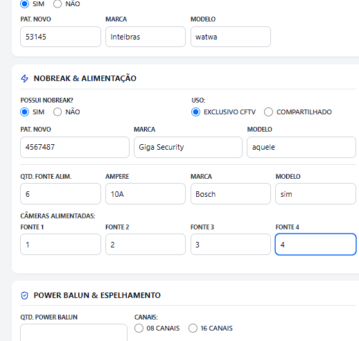
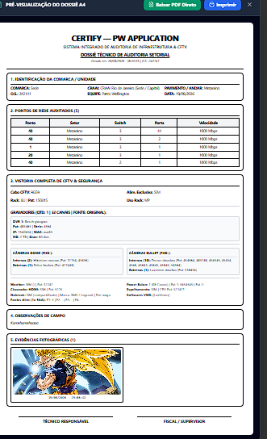
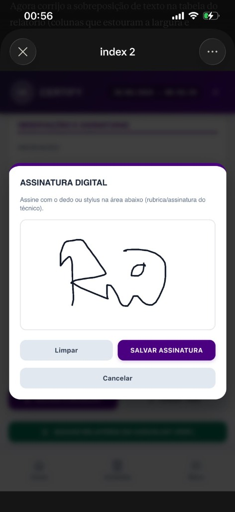

  <strong>English</strong> | <a href="README.pt-BR.md">Português</a>

# PW OpsDesk — Enterprise Operations & ITSM Dispatch Architecture 🏢📡

> **Architectural Showcase & System Design Specification.**  
> Central command desk for mission-critical operations, field service inspection, and biometric auditing developed for public agencies and enterprise telecom/CCTV infrastructure.  
> *Developed and maintained by [PW-SYSTEM](https://github.com/PW-SYSTEM).*

---

## 📌 High-Level Architecture (Event-Driven Dispatch)

PW OpsDesk operates as the nervous system connecting mobile field inspectors, supervisors, and administrative dispatchers via a dual-channel REST + WebSockets backbone.

---

## 📸 Production Operational Showcase

Field captures from enterprise deployments demonstrating dispatcher controls, mobile inspection workflows, and cryptographic evidence sealing:

<table width="100%">
  <tr>
    <td width="50%" align="center" valign="top">
      
      
<strong>Operational Dispatch Hub:</strong> Real-time ticket routing, live supervisor radar, and queue governance.

    </td>
    <td width="50%" align="center" valign="top">
      
      
<strong>Network Infrastructure Mapping:</strong> Switch port auditing, topology discovery, and telecom rack verification.

    </td>
  </tr>
  <tr>
    <td width="50%" align="center" valign="top">
      
      
<strong>CCTV Camera Compliance Checklist:</strong> Point-to-point stream validation, optic alignment, and physical hardening.

    </td>
    <td width="50%" align="center" valign="top">
      
      
<strong>Forensic PDF Audit Dossier:</strong> Digitally signed, tamper-evident inspection reports generated in real time.

    </td>
  </tr>
  <tr>
    <td colspan="2" align="center" valign="top">
      
      
<strong>Biometric & Digital Signature Modal:</strong> Field client seal with GPS coordinate locking and SHA-256 integrity hash.

    </td>
  </tr>
</table>

---

## 🎮 Interactive Live Playground — PW Ecosystem Bridge

OpsDesk includes an interactive **Certify Bridge Simulator** accessible directly from the sidebar (`📡 Ponte Certify (LIVE)`), allowing real-time testing of the 3 flagship mobile field applications without needing physical Android devices:

| Mobile Client | Operational Domain | Real-World Customer Reference | Simulated Scenario |
| :--- | :--- | :--- | :--- |
| **PW Resolve IT** | Corporate IT & Field OS | Ministério Público (MPRJ) | Network wall-jack repair, patch cord replacement, photo evidence & customer signature. |
| **Certify Legado** | Telecom & Fiber Infrastructure | Getel / Centauro Seguradora | Fiber link break, SLA pause during site access clearance (`AGUARDANDO_ACESSO`), and OTDR fusion splicing report. |
| **Certify Enterprise** | CCTV, Physical Security & Fluke | High-Density Enterprise Surveillance | P1 critical NVR/PoE switch breakdown, Fluke DSX cable diagnostic note, and power reconfiguration resolution. |

Every simulated step executes through the **real integration transport layer** (`EcosystemAdapters.handleRemoteIngest`, `handleStatusSync`, `handleRemoteResolution`), triggering live WebSocket broadcasts (`ticket:created`, `ticket:updated`, `ticket:remote_resolved`), real-time notification chimes, and cryptographic audit log entries.

---

## 🛡️ Enterprise Governance & Security Matrix

### 1. Granular Role-Based Access Control (RBAC)
- **Field Operator:** Restricted to assigned ticket scope, camera/photo capture, and geolocation check-in.
- **Field Supervisor (Master):** Ticket delegation, biometric identity approval, and real-time inspector radar tracking.
- **System Administrator:** Full audit trail inspection, tenant provisioning, and global compliance configuration.

### 2. Offline-First Resilience
- Field inspections often occur in basements, underground hubs, or areas with zero 4G/5G connectivity.
- Inspecting devices store operations in an atomic SQLite WAL queue. Upon signal recovery, an idempotent reconciliation protocol flushes queued events with zero data collision.

### 3. Biometric & Forensic Audit Trail
- Each field action is sealed with GPS coordinate triangulation, device hardware fingerprint, and cryptographic hash timestamp preventing retroactive report tampering.

---

## 📊 Technical Specifications & Throughput SLA

| Parameter | Specification / Benchmark |
| :--- | :--- |
| **Event Throughput** | **> 12,000 messages/sec** (Socket.io Cluster) |
| **Average Dispatch Latency** | **< 38 ms** (Standard 4G LTE Network) |
| **Data Persistence** | SQLite WAL Mode with ACID Atomic Transactions |
| **Technical Report Generation** | Async PDFKit in < 450ms per report with forensic photos |
| **ITSM Integration** | HaloITSM REST API v2 (Bidirectional Webhooks) |

---

## 🔒 Commercial Notice
*This repository serves as the public architectural specification and case study. The underlying production codebase, proprietary algorithms, and deployment manifests are private commercial assets of [PW-SYSTEM](https://github.com/PW-SYSTEM).*
