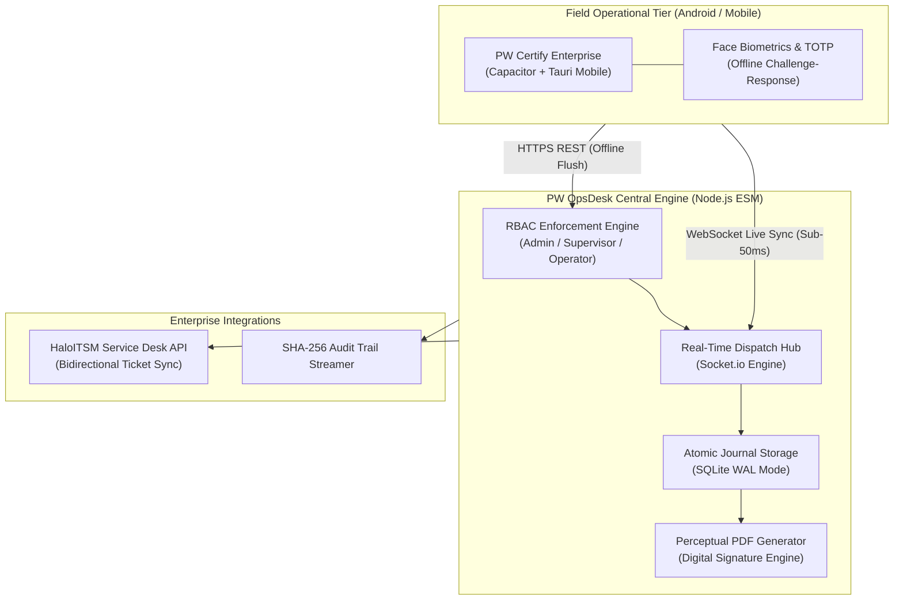

  <strong>English</strong> | <a href="README.pt-BR.md">Português</a>

# PW OpsDesk — Enterprise Operations & ITSM Dispatch Architecture 🏢📡

> **Architectural Showcase & System Design Specification.**  
> Central command desk for mission-critical operations, field service inspection, and biometric auditing developed for public agencies and enterprise telecom/CCTV infrastructure.  
> *Developed and maintained by [Lorinmr-dev](https://github.com/Lorinmr-dev).*

---

## 📌 High-Level Architecture (Event-Driven Dispatch)

PW OpsDesk operates as the nervous system connecting mobile field inspectors, supervisors, and administrative dispatchers via a dual-channel REST + WebSockets backbone.

---

## 🛡️ Enterprise Governance & Security Matrix

### 1. Granular Role-Based Access Control (RBAC)
- **Field Operator:** Restricted to assigned ticket scope, camera/photo capture, and geolocation check-in.
- **Field Supervisor (Master):** Ticket delegation, biometric identity approval, and real-time inspector radar tracking.
- **System Administrator:** Full audit trail inspection, tenant provisioning, and global compliance configuration.

### 2. Offline-First Resilience
- Field inspections often occur in basements, underground hubs, or areas with zero 4G/5G connectivity.
- Inspecting devices store operations in an atomic SQLite WAL queue. Upon signal recovery, an idempotent reconciliation protocol flushes queued events with zero data collision.

### 3. Biometric & Forensic Audit Trail
- Each field action is sealed with GPS coordinate triangulation, device hardware fingerprint, and cryptographic hash timestamp preventing retroactive report tampering.

---

## 📊 Technical Specifications & Throughput SLA

| Parameter | Specification / Benchmark |
| :--- | :--- |
| **Event Throughput** | **> 12,000 messages/sec** (Socket.io Cluster) |
| **Average Dispatch Latency** | **< 38 ms** (Standard 4G LTE Network) |
| **Data Persistence** | SQLite WAL Mode with ACID Atomic Transactions |
| **Technical Report Generation** | Async PDFKit in < 450ms per report with forensic photos |
| **ITSM Integration** | HaloITSM REST API v2 (Bidirectional Webhooks) |

---

## 🔒 Commercial Notice
*This repository serves as the public architectural specification and case study. The underlying production codebase, proprietary algorithms, and deployment manifests are private commercial assets of [Lorinmr-dev](https://github.com/Lorinmr-dev).*
