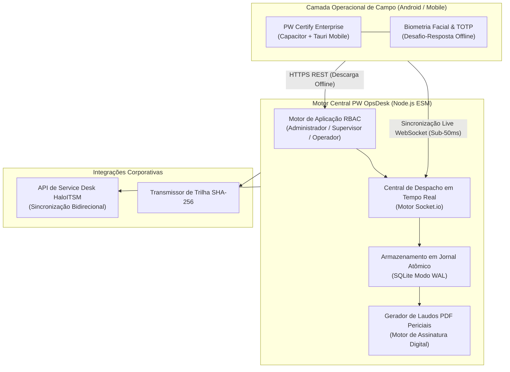

  <a href="README.md">English</a> | <strong>Português</strong>

# PW OpsDesk — Central Operacional & Arquitetura de Despacho ITSM 🏢📡

> **Vitrine Arquitetural & Especificação de Design de Sistemas.**  
> Central de comando para operações de missão crítica, inspeção técnica em campo e auditoria biométrica pericial desenvolvida para concessionárias, órgãos públicos e infraestrutura de telecomunicações/CFTV.  
> *Desenvolvido e mantido por [PW-SYSTEM](https://github.com/PW-SYSTEM).*

---

## 📌 Arquitetura de Alto Nível (Despacho Orientado a Eventos)

O PW OpsDesk atua como o sistema nervoso central conectando inspetores móveis em campo, supervisores operacionais e despachantes administrativos através de um canal híbrido REST + WebSockets.

---

## 🛡️ Matriz de Segurança & Governança Corporativa

### 1. Controle de Acesso Baseado em Papéis (RBAC Granular)
- **Operador de Campo:** Acesso restrito ao escopo do chamado atribuído, captura de fotos periciais e confirmação de presença via GPS.
- **Supervisor de Campo (Master):** Delegação de chamados, homologação biométrica de identidade e radar de rastreamento de equipes em tempo real.
- **Administrador do Sistema:** Acesso total à trilha de auditoria, provisionamento de instâncias corporativas e governança de conformidade.

### 2. Resiliência com Arquitetura Offline-First
- Inspeções técnicas frequentemente ocorrem em subsolos, estações remotas ou áreas com ausência de sinal de rede celular (4G/5G).
- Os dispositivos armazenam eventos em uma fila atômica SQLite WAL. Ao restabelecer conectividade, um protocolo de reconciliação idempotente descarrega os registros sem conflitos de dados.

### 3. Trilha de Auditoria Pericial & Biométrica
- Cada registro de campo é selado com triangulação de coordenadas geográficas, impressão digital do dispositivo (*hardware fingerprint*) e carimbo de tempo com hash criptográfico, impossibilitando adulterações retroativas.

---

## 📊 Especificações Técnicas & SLA de Vazão

| Parâmetro | Especificação / Benchmark |
| :--- | :--- |
| **Vazão de Eventos (Throughput)** | **> 12.000 mensagens/segundo** (Cluster Socket.io) |
| **Latência Média de Despacho** | **< 38 ms** (Rede móvel 4G LTE padrão) |
| **Persistência de Dados** | SQLite Modo WAL com transações atômicas ACID |
| **Geração de Laudos Técnicos** | PDFKit assíncrono em < 450ms por laudo com fotos periciais |
| **Integração ITSM** | HaloITSM REST API v2 (Webhooks bidirecionais) |

---

## 🔒 Aviso Comercial
*Este repositório atua como especificação pública de arquitetura e estudo de caso técnico. O código-fonte de produção, algoritmos proprietários e manifestos de implantação são ativos comerciais privados da [PW-SYSTEM](https://github.com/PW-SYSTEM).*
