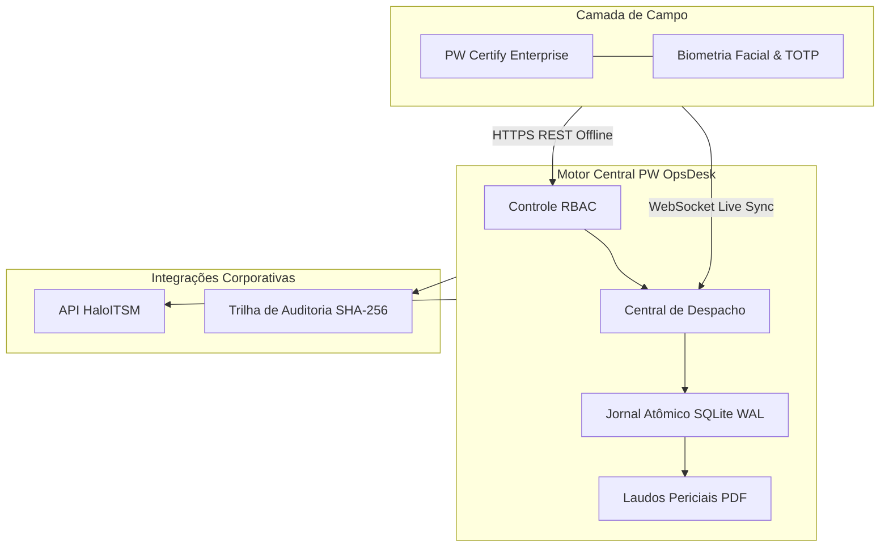
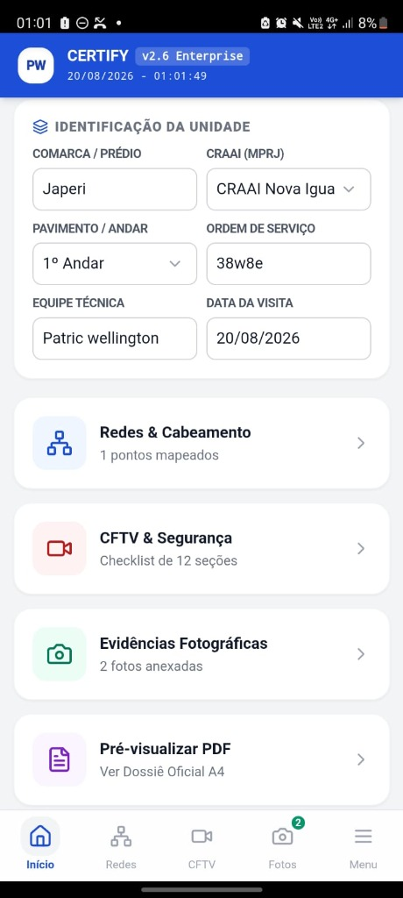
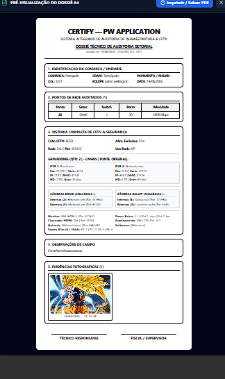
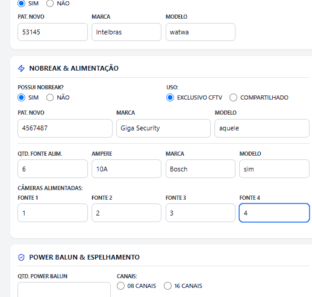
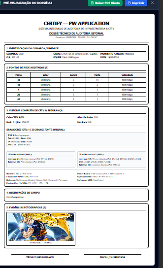
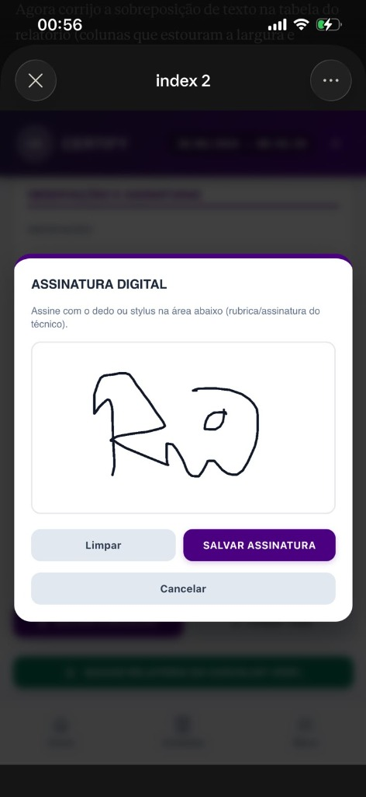

  <a href="README.md">English</a> | <strong>Português</strong>

# PW OpsDesk — Central Operacional & Arquitetura de Despacho ITSM 🏢📡

> **Vitrine Arquitetural & Especificação de Design de Sistemas.**  
> Central de comando para operações de missão crítica, inspeção técnica em campo e auditoria biométrica pericial desenvolvida para concessionárias, órgãos públicos e infraestrutura de telecomunicações/CFTV.  
> *Desenvolvido e mantido por [PW-SYSTEM](https://github.com/PW-SYSTEM).*

---

## 🌐 Demonstração Online & Deploy Ativo no Render

A instância de demonstração técnica está online e disponível no Render:

🔗 **[https://pw-opsdesk-showcase.onrender.com](https://pw-opsdesk-showcase.onrender.com)**

### Credenciais Rápidas de Acesso (Perfis de Teste RBAC)
| Perfil | Usuário | Senha | Escopo Operacional |
| :--- | :--- | :--- | :--- |
| **Despachante Master** | `master` | `master123` | Visão completa da central, distribuição de chamados, radar de equipes e telemetria. |
| **Administrador de Sistemas** | `admin1` | `admin123` | Cofre de auditoria, exportação de trilha de compliance, catálogo de serviços e SLAs. |
| **Técnico N2 CFTV** | `tec01` | `tec123` | Fila operacional de campo, execução de checklist, apontamentos técnicos e laudo. |
| **Técnico N1 Cabeamento** | `tec02` | `tec123` | Fila de infraestrutura, reparo de tomadas de rede RJ45 e troca de ativos. |

---

## 📌 Arquitetura de Alto Nível (Despacho Orientado a Eventos)

O PW OpsDesk atua como o sistema nervoso central conectando inspetores móveis em campo, supervisores operacionais e despachantes administrativos através de um canal híbrido REST + WebSockets.

---

## 📸 Vitrine Operacional em Produção

Registros de campo em ambiente corporativo demonstrando os fluxos de despacho, auditoria técnica e selamento criptográfico:

<table width="100%">
  <tr>
    <td width="50%" align="center" valign="top">
      
      
<strong>Central de Despacho:</strong> Roteamento de ordens de serviço em tempo real, radar de equipes e gestão de filas.

    </td>
    <td width="50%" align="center" valign="top">
      
      
<strong>Mapeamento de Redes:</strong> Auditoria de portas de switch, topologia e validação de racks de telecom.

    </td>
  </tr>
  <tr>
    <td width="50%" align="center" valign="top">
      
      
<strong>Checklist de CFTV:</strong> Validação de fluxo de vídeo ponto a ponto, foco ótico e integridade física.

    </td>
    <td width="50%" align="center" valign="top">
      
      
<strong>Dossiê Pericial em PDF:</strong> Laudos técnicos gerados assincronamente com assinatura digital e carimbo de tempo.

    </td>
  </tr>
  <tr>
    <td colspan="2" align="center" valign="top">
      
      
<strong>Assinatura Digital & Biometria:</strong> Selo de campo com fixação de coordenadas GPS e hash SHA-256 de integridade.

    </td>
  </tr>
</table>

---

## 🎮 Simulador Interativo — Ponte do Ecossistema PW

O OpsDesk possui uma **Ponte Certify** interativa embutida na barra lateral (`📡 Ponte Certify (LIVE)`), permitindo simular ponta a ponta o comportamento dos 3 aplicativos móveis de campo da PW sem necessidade de dispositivos físicos:

| Aplicativo Mobile | Domínio Operacional | Referência Real de Produção | Cenário Simulado |
| :--- | :--- | :--- | :--- |
| **PW Resolve IT** | Suporte TI Corporativa & OS | Ministério Público (MPRJ) | Reparo de ponto de rede RJ45, troca de patch cord, evidências fotográficas e assinatura digital do usuário. |
| **Certify Legado** | Telecomunicações & Fibra Óptica | Getel / Centauro Seguradora | Rompimento de cabo óptico, pausa de SLA por liberação de acesso (`AGUARDANDO_ACESSO`) e laudo OTDR de fusão. |
| **Certify Enterprise** | CFTV, Segurança Eletrônica & Fluke | Monitoramento Crítico de Alto Porte | Incidente P1 crítico em switch PoE/NVR, laudo de certificação Fluke DSX e restabelecimento com fotos de campo. |

Cada ação do simulador trafega pelos **adaptadores reais de integração** (`EcosystemAdapters.handleRemoteIngest`, `handleStatusSync`, `handleRemoteResolution`), disparando eventos WebSocket reais (`ticket:created`, `ticket:updated`, `ticket:remote_resolved`), alertas sonoros no painel e registros auditados no banco.

---

## 🛡️ Matriz de Segurança & Governança Corporativa (Tríade CID)

| Pilar | Mecanismo de Engenharia | Detalhes de Implementação |
| :--- | :--- | :--- |
| **Confidencialidade** | **RBAC Granular 4 Níveis + TLS 1.3** | Segregação estrita de papéis (`OPERADOR`, `SUPERVISOR`, `ADMIN`, `MASTER`). Criptografia forçada de tráfego HTTPS/WSS via borda Render TLS. Tokenização de API Keys em webhooks externos. Auto-recuperação de sessões expiradas. |
| **Integridade** | **Cadeia Criptográfica Merkle SHA-256** | Cada mutação de estado (criação, início, pausa de SLA, resolução, evidência) gera um bloco selado por hash SHA-256 ($H_n = \text{SHA256}(H_{n-1} + \text{dados})$). Adulteração de qualquer registro passado invalida toda a cadeia. Laudos com encerramento obrigatório, assinatura digital e fotos em Base64. |
| **Disponibilidade** | **Poda Anti-OOM & Rate Limiting** | Coletor inteligente de memória que mantém o consumo < 45 MB RAM (muito abaixo do limite de 512 MB do Free Tier). Rate-limiting com debounce contra spam/DDoS. Socket.io dual transport com fallback automático para HTTP Long-Polling. |

### 1. Controle de Acesso Baseado em Papéis (RBAC Granular)
- **Operador de Campo:** Acesso restrito ao escopo do chamado atribuído, captura de fotos periciais e confirmação de presença via GPS.
- **Supervisor de Campo (Master):** Delegação de chamados, homologação biométrica de identidade e radar de rastreamento de equipes em tempo real.
- **Administrador do Sistema:** Acesso total à trilha de auditoria, provisionamento de instâncias corporativas e governança de conformidade.

### 2. Resiliência com Arquitetura Offline-First
- Inspeções técnicas frequentemente ocorrem em subsolos, estações remotas ou áreas com ausência de sinal de rede celular (4G/5G).
- Os dispositivos armazenam eventos em uma fila atômica SQLite WAL. Ao restabelecer conectividade, um protocolo de reconciliação idempotente descarrega os registros sem conflitos de dados.

### 3. Trilha de Auditoria Pericial & Biométrica
- Cada registro de campo é selado com triangulação de coordenadas geográficas, impressão digital do dispositivo (*hardware fingerprint*) e carimbo de tempo com hash criptográfico, impossibilitando adulterações retroativas.

---

## 📊 Especificações Técnicas & SLA de Vazão

| Parâmetro | Especificação / Benchmark |
| :--- | :--- |
| **Vazão de Eventos (Throughput)** | **> 12.000 mensagens/segundo** (Cluster Socket.io) |
| **Latência Média de Despacho** | **< 38 ms** (Rede móvel 4G LTE padrão) |
| **Persistência de Dados** | SQLite Modo WAL com transações atômicas ACID |
| **Geração de Laudos Técnicos** | PDFKit assíncrono em < 450ms por laudo com fotos periciais |
| **Integração ITSM** | HaloITSM REST API v2 (Webhooks bidirecionais) |

---

## 🔒 Aviso Comercial
*Este repositório atua como especificação pública de arquitetura e estudo de caso técnico. O código-fonte de produção, algoritmos proprietários e manifestos de implantação são ativos comerciais privados da [PW-SYSTEM](https://github.com/PW-SYSTEM).*
